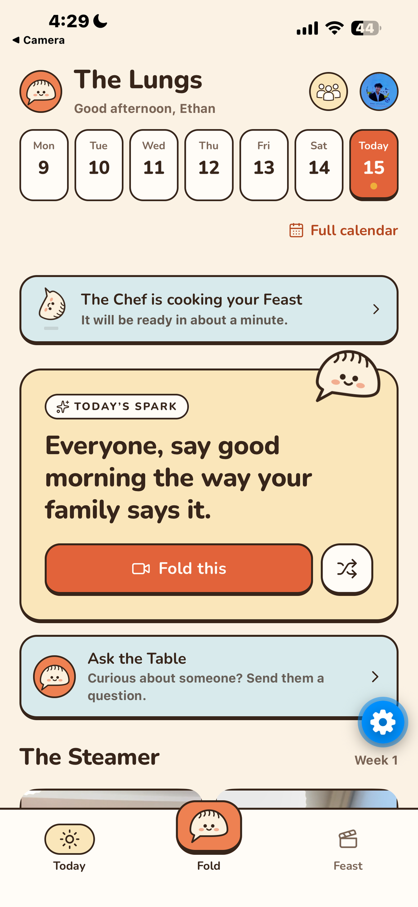
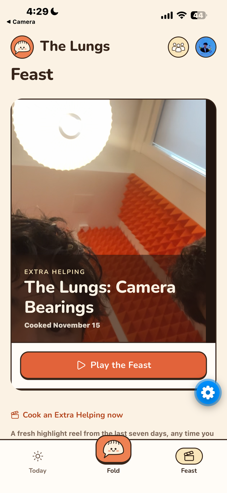
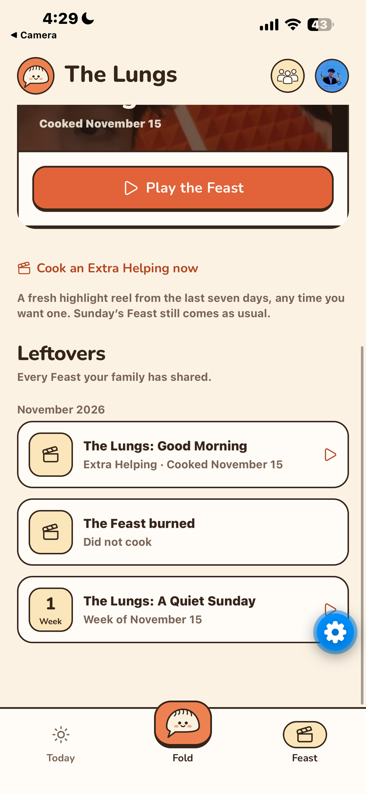
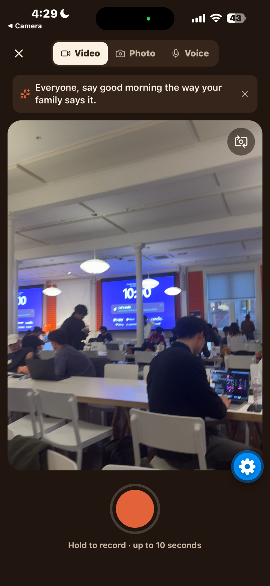

# Dumpling 🥟

Your family's week, turned into a show you watch together every Sunday.

We both left home to study abroad. What we miss most isn't the holidays, it's dinner: everyone at one table, talking over each other. Dumpling is our attempt to get a bit of that back, ten seconds at a time.

Built in one day at the YC Consumer Mobile Hackathon by Eason Gan and Ethan Lung.

<p align="center">
  
  
  
  
</p>

## How it works

* **Your Table.** A private space for your family and nobody else.
* **Today's Spark.** One small idea to film each day. Don't like it? Shuffle it, or ignore it and film whatever you want.
* **Fold a Dumpling.** Hold to record. Ten seconds max, video or voice only.
* **The Steamer.** Fold yours and you get to see everyone else's.
* **Ask the Table.** Curious how someone's really doing? Send them a question.
* **The Feast.** Every Sunday, the week's Dumplings become a short show for the whole family.
* **Grandparents.** Add them by phone number. They get the Feast as a link, with nothing to install.

## Why people come back

There are no streaks and nothing to keep up with. The daily clip takes ten seconds, the Feast gives you a reason to show up on Sunday, and the archive gets more valuable every week you use it.

## Built with

* Expo and React Native (TypeScript, Expo Router)
* Convex for the backend, file storage and scheduled jobs
* OpenAI for transcription and the Feast script
* Capy for building, Revyl for testing on real devices

## Run it

```bash
npm install
npx convex dev      # in one terminal
npx expo start      # in another
```

Set `OPENAI_API_KEY` in your Convex environment variables, then scan the QR code with Expo Go.

## What's next

* Sealed clips that stay hidden until the Feast
* Monthly and yearly recaps
* A text message bot, so grandparents can send clips without the app

## Team

* Ethan Lung
* Eason Gan

